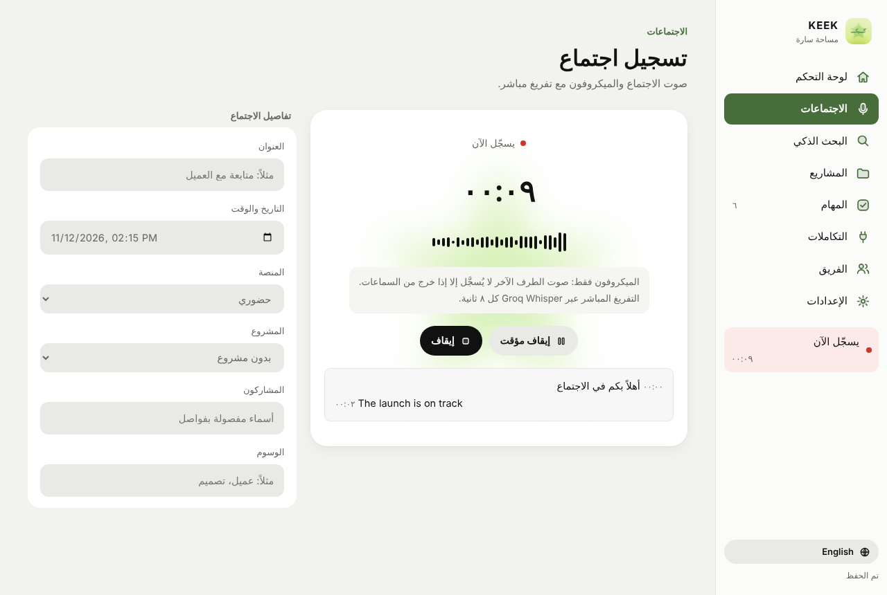

# KEEK Suite — Desktop app + Browser extension + free AI (Groq & Gemini)

KEEK (كيكـ) is a bilingual (Arabic / English) meeting-intelligence workspace: record or import a meeting,
get a transcript, summary, decisions and action items linked to the exact transcript lines, and ask
questions across all your meetings. This repository turns the original single-file KEEK web app into:

| Part | What it does |
|---|---|
| **KEEK Desktop** (`desktop/`, Electron) | Records **system audio + microphone** with no meeting bot, live-transcribes, stores everything as local files, encrypts your API keys, and exposes a local bridge for the extension. Windows · macOS · Linux. |
| **KEEK Extension** (`extension/`, Chrome MV3) | Detects Google Meet / Zoom web / Teams web, records the **meeting tab + your mic** right in the browser, and can start/stop recording in KEEK Desktop. Contains the full KEEK app. |
| **KEEK NLP** (`shared/nlp/keek-nlp.js`) | One dependency-free module for the **free tiers of Groq and Google Gemini**: analysis, JSON extraction, streaming answers, speech-to-text (Whisper / Gemini), automatic routing and fallback. |
| **Shared app** (`shared/app/`) | The KEEK UI used by both, plus `keekx.js` — the layer that adds AI settings, audio capture, live transcription and file transcription. |

Everything runs on your machine with **your own free API keys** — there is no KEEK server or account.



## Quick start

1. **Get a free key** (one is enough, both is best) — [docs/02-free-api-keys.md](docs/02-free-api-keys.md)
   - Groq: <https://console.groq.com/keys> (fast Whisper transcription + Llama analysis)
   - Gemini: <https://aistudio.google.com/apikey> (long meetings, speaker labels)
2. **Desktop app** — needs Node.js 20+:
   ```bash
   cd desktop
   npm install
   npm start                 # run
   npm run dist              # build an installer for your OS → desktop/dist/
   ```
3. **Browser extension** — Chrome / Edge / Brave → `chrome://extensions` → enable *Developer mode* →
   *Load unpacked* → pick the `extension/` folder.
4. Open KEEK → **Settings → AI** → paste your key → **Save** (it’s tested automatically).
5. Pair the extension with the desktop app: Desktop → **Integrations** → copy the pairing code →
   extension popup → paste → **Pair**.

Full guides: [Desktop](docs/03-desktop-app.md) · [Extension](docs/04-browser-extension.md) · [دليل عربي](docs/ar/README-ar.md)

## What works

- **Capture**: system audio loopback (desktop), meeting-tab audio (extension), any input device (BlackHole, VB-Cable…), plus mic — mixed into one recording.
- **Live transcription** every 8–60 s via Groq Whisper or Gemini (Arabic incl. Egyptian dialect, English, and mixed speech), with silence skipping and Whisper-hallucination filtering. Browser speech recognition is used as a free fallback when available.
- **Upload & transcribe** audio/video files (MP3, M4A, WAV, WebM, MP4, OGG, FLAC). Large files are split into 5-minute chunks automatically.
- **Analysis**: overview, topics, key points, decisions, action items (owner/due only when said), open questions, risks, follow-up email — every item cites transcript lines.
- **AI search** across meetings with streamed, cited answers; projects, tasks, exports (TXT, Markdown, CSV, JSON).
- **Routing**: short prompts → Groq (fast), long prompts → Gemini (1M context); automatic fallback on rate limits, size limits, outages or bad JSON.
- **Extension ↔ Desktop**: pair once, then start/stop desktop recording from the meeting tab; the meeting title, link and platform are filled in.

## Repository layout

```
keek-suite/
├── README.md
├── docs/                       ← all documentation (EN + Arabic quick start)
├── shared/
│   ├── original/keek.html      ← your original single-file app (source of truth for the UI)
│   ├── app/                    ← shared renderer: index.html, app.js, keekx.js, platform.js (browser)
│   └── nlp/                    ← keek-nlp.js (+ tests)
├── desktop/                    ← Electron app
│   ├── src/                    ← main.js, preload.js, store.js, config.js, bridge.js, keek-nlp.js
│   ├── renderer/               ← synced shared app + desktop platform.js
│   ├── build/                  ← icons, macOS entitlements
│   └── test/
├── extension/                  ← Chrome MV3 extension
│   ├── manifest.json, background.js, content.js
│   ├── popup/                  ← popup UI
│   ├── app/                    ← synced shared app (full KEEK inside the extension)
│   └── icons/
└── tools/
    ├── extract_app.py          ← rebuild shared/app from a new keek.html
    ├── sync.mjs                ← copy shared/ into desktop/ and extension/
    └── *smoke*.cjs             ← headless-Chrome end-to-end tests
```

## Tests

```bash
node --test shared/nlp/keek-nlp.test.js desktop/test/main-modules.test.js   # 18 unit tests, no network
npm i -D playwright                                                           # optional, for E2E
node tools/smoke-test.cjs && node tools/desktop-renderer-smoke.cjs && node tools/extension-smoke.cjs
```
The end-to-end tests mock Groq, so no real keys are needed. See [docs/09-development.md](docs/09-development.md).

## Honest limits

- Free tiers are rate-limited and change often (see [docs/02](docs/02-free-api-keys.md)). KEEK retries, falls back to the other provider, and tells you when a limit is hit.
- **macOS system audio**: depends on your macOS and Electron version; if loopback gives no audio, use a free virtual device (BlackHole) — [docs/03](docs/03-desktop-app.md#macos-system-audio).
- Data you send to Groq/Gemini follows their terms; Gemini’s free tier may use content to improve Google products. Don’t process meetings you can’t share with them — [docs/07](docs/07-privacy-security.md).
- Always tell participants before recording. KEEK asks you to confirm consent each time.

## Documentation index

1. [Architecture](docs/01-architecture.md)
2. [Free API keys & limits](docs/02-free-api-keys.md)
3. [Desktop app](docs/03-desktop-app.md)
4. [Browser extension](docs/04-browser-extension.md)
5. [NLP module API](docs/05-nlp-module.md)
6. [Extension ↔ Desktop bridge protocol](docs/06-bridge-protocol.md)
7. [Privacy & security](docs/07-privacy-security.md)
8. [Troubleshooting](docs/08-troubleshooting.md)
9. [Development, testing & packaging](docs/09-development.md)
10. [دليل البدء السريع بالعربية](docs/ar/README-ar.md)
