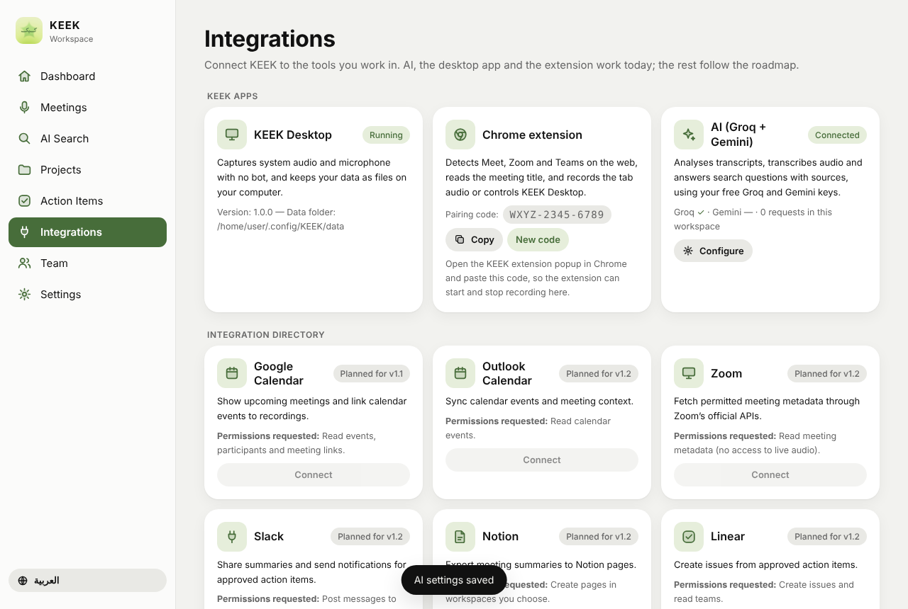

# 3. KEEK Desktop (Electron)

## Run from source

Requirements: **Node.js 20+** and npm. Internet access for `npm install` (downloads Electron).

```bash
cd desktop
npm install
npm start          # normal
npm run dev        # with DevTools and AI logs
```

Optional for development — keys from environment variables override saved ones:
```bash
GROQ_API_KEY=gsk_... GEMINI_API_KEY=AIza... npm start
```

## Build installers

```bash
npm run dist        # current OS
npm run dist:win    # NSIS installer (.exe)
npm run dist:mac    # .dmg (build on a Mac)
npm run dist:linux  # AppImage + .deb
```
Output goes to `desktop/dist/`. Builds are unsigned by default:
- **Windows** shows a SmartScreen warning → *More info → Run anyway*. Sign with a code-signing certificate for distribution (`CSC_LINK`, `CSC_KEY_PASSWORD`).
- **macOS** needs signing + notarisation to open without warnings (`CSC_LINK`, `APPLE_ID`, `APPLE_APP_SPECIFIC_PASSWORD`, `APPLE_TEAM_ID`). Unsigned: right-click the app → *Open*.

## First run

1. Choose language, name, workspace type, then *Empty* or *Sample* workspace.
2. **Settings → AI** → paste a Groq and/or Gemini key → **Save settings**.
3. **Meetings → + → Record with the desktop app** → choose *Meeting audio* and *Microphone* → tick consent → **Start recording**.



## Audio capture

| Source | How | Notes |
|---|---|---|
| All computer audio (loopback) | `getDisplayMedia` answered by the main process with screen + `audio: 'loopback'` (no picker) | Windows: works out of the box. Linux: depends on PipeWire/PulseAudio. macOS: see below. |
| Input device | any audio input, e.g. BlackHole, VB-Cable, a USB interface | Pick it under *Meeting audio* |
| Microphone | default or chosen device, echo-cancelled | Always recorded |

Both sources are mixed into one recording. **Use headphones** so the mic doesn’t pick up the speakers.
If meeting audio can’t be captured, KEEK says why and continues with the mic only.

### macOS system audio
1. The first loopback recording asks for **Screen Recording** permission (System Settings → Privacy & Security → Screen & System Audio Recording → enable KEEK, then restart KEEK). The screen image itself is not recorded or stored.
2. If you still get no meeting audio (older macOS or Electron without macOS loopback), install the free **BlackHole 2ch**, create a *Multi-Output Device* in *Audio MIDI Setup* (your speakers + BlackHole), set it as output, and choose *Input device: BlackHole 2ch* as KEEK’s meeting audio.

## Live transcription

Every *N* seconds (Settings → AI → *Live chunk length*, default 20) the latest audio is converted to
16 kHz WAV and transcribed. Spoken language: Egyptian Arabic, MSA, English, or **Auto / mixed** (best
for Arabic–English code-switching). The window keeps transcribing while minimised.
When you stop, the last chunks finish before you can save. If live transcription was off or failed,
use **Transcribe the recording with AI** on the review screen.

## Where your data lives

| OS | Folder |
|---|---|
| Windows | `%APPDATA%\KEEK\` |
| macOS | `~/Library/Application Support/KEEK/` |
| Linux | `~/.config/KEEK/` |

- `data/…/*.json` — workspace, one file per meeting (plain JSON — back it up by copying the folder).
- `keek-config.json` — settings, the **encrypted** API keys (Keychain / DPAPI / libsecret via Electron `safeStorage`) and the pairing code.
- Recorded audio stays in memory for the session (playback/export of original audio is on the roadmap); transcripts are saved.

Settings → Privacy → **Export all data (JSON)** / **Delete all data** work as in the web app.

## Global shortcut

**Ctrl/Cmd + Shift + Alt + R** — stop a running recording, or bring up the recorder.

## Bridge for the extension

KEEK Desktop listens on `127.0.0.1:47821` (next free port up to 47825). Copy the pairing code from
**Integrations → Chrome extension**; use **New code** to revoke the old one. Protocol:
[06-bridge-protocol.md](06-bridge-protocol.md).
