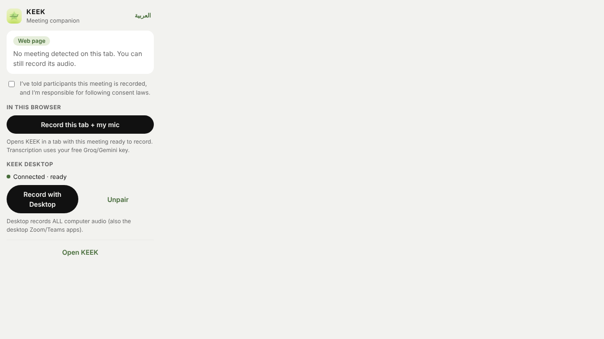
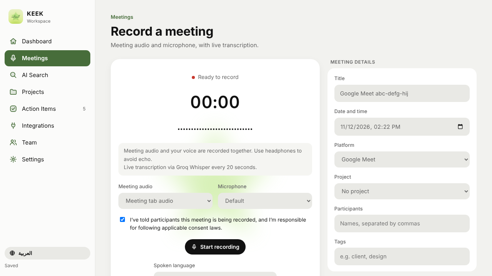

# 4. KEEK browser extension (Chrome MV3)

Works in Chrome 116+, Edge, Brave and other Chromium browsers.

## Install (unpacked)

1. Open `chrome://extensions` (Edge: `edge://extensions`).
2. Turn on **Developer mode**.
3. **Load unpacked** → select the `extension/` folder.
4. The KEEK app opens in a tab on first install. Pin the KEEK icon to the toolbar.
5. In the app: **Settings → AI** → add your Groq/Gemini key.

To publish on the Chrome Web Store, zip the *contents* of `extension/` and upload it in the developer
dashboard; the store listing must disclose that audio/transcripts are sent to Groq/Google.

## What it does

- **Meeting detection** on `meet.google.com`, `*.zoom.us` (web client), `teams.microsoft.com`,
  `teams.live.com`, `teams.cloud.microsoft`. It reads only the page title, the meeting address
  (query string removed — passcodes are never read) and whether a call looks active. A green ● badge
  shows on tabs that are in a call; **REC** shows while KEEK is recording.
- **Record this tab + my mic** — opens the KEEK tab with the meeting pre-filled (title, link,
  platform) and *Meeting tab audio* selected. Press **Start recording** there. The meeting stays
  audible to you (KEEK plays the captured tab back).
- **Record with Desktop** — if KEEK Desktop is running and paired, starts/stops recording there
  (captures *all* computer audio, including the desktop Zoom/Teams apps).
- **Open KEEK** — the full KEEK app (meetings, search, projects, tasks…) inside the extension.

 

## Pairing with KEEK Desktop

1. Desktop → **Integrations** → *Chrome extension* → **Copy** the code (`ABCD-EFGH-JKLM`).
2. Click the KEEK icon → paste into *KEEK Desktop* → **Pair**.
3. Status changes to *Connected · ready*. **Unpair** forgets the code; *New code* on the desktop revokes it.

## Recording rules

- Tick the consent box before starting (required by both the popup and the recorder).
- Tab capture needs the popup to have been opened **on the meeting tab** (Chrome’s `activeTab` rule).
  If KEEK says capture was refused, click the KEEK icon on the meeting tab again, then Start.
- The extension can also record **"Share a tab or screen with audio"** (any tab via Chrome’s picker;
  tick *Share audio*), or just the microphone.

## Permissions and why

| Permission | Why |
|---|---|
| `tabCapture`, `activeTab` | record the audio of the meeting tab you clicked KEEK on |
| `storage`, `unlimitedStorage` | keep your workspace and settings in the browser profile |
| host `api.groq.com`, `generativelanguage.googleapis.com` | call the AI providers with your key |
| host `127.0.0.1` | talk to KEEK Desktop’s local bridge |
| content script on Meet/Zoom/Teams | detect meetings and read their titles |

No analytics, no remote code, no KEEK server.

## Data

Workspace and keys live in `chrome.storage.local` of this browser profile (keys are not encrypted
there — use the desktop app if that matters). Removing the extension deletes them.
Export first via **Settings → Privacy → Export all data**.
